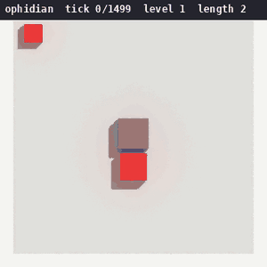

# Ophidian

[](https://danielstephenson.dev/play/ophidian)

This game allows you to control an ever-increasingly growing ophidian in a virtual environment. 

## Play in your browser
Ophidian also runs in a web browser, phones included, with nothing to install:

- https://ophidian.play.danielstephenson.dev
- https://danielstephenson.dev/play (every browser game in one place)

Click or tap the page once to start it. On a phone, swipe to steer, or tap a
spot on the board to turn towards it. The browser build is the graphical UI
built with [pygbag](https://github.com/pygame-web/pygbag) from `src/`, whose
`main.py` is its entry point (`python -m pygbag --build src` builds it into
`src/build/web`); `.github/workflows/browser.yml` builds it on every pull request
and every push to `main`, and deploys it from a push to `main` when the
`ARCADE_ENABLED` variable is `true`, or from a manual run. Two things differ
there: progress (`save.json`) lasts only as long as the tab, and no usage
reporting is sent at all. There is no quit key, as
closing the tab ends the game.

## Requirements
- Python 3.8 or newer (developed and tested on 3.10)
- [pygame](https://www.pygame.org/) — only for the graphical UI; `--text-ui` runs without it

## Installation
```bash
git clone https://github.com/Preponderous-Software/ophidian.git
cd ophidian
pip install -r requirements.txt
```

To run the tests or the formatter, install the development dependencies
(`pytest`, `pytest-cov`, `black`, `autoflake`) instead:
```bash
pip install -r requirements-dev.txt
```

## Usage

### Graphical UI (Default)
Run the game with the standard pygame graphical interface:
```bash
python3 src/ophidian.py
```

### Text-Based UI
Run the game with a text-based terminal interface:
```bash
python3 src/ophidian.py --text-ui
```

`./run.sh` starts the graphical UI too, after pulling the latest code and running
the tests. It sends the game's console output to `output.txt` rather than the
terminal, so the first-run usage reporting notice and the console copy of each
obituary and its chronicle end up in that file. `./run.sh` and `./test.sh` pick
the interpreter themselves — `python3` first, then `python`, taking whichever
reports 3.8 or newer — so set `PYTHON` to override that choice:
```bash
PYTHON=.venv/bin/python ./test.sh
```

The text-based UI is perfect for:
- Environments where graphical display is not available
- Running the game over SSH
- Low-resource systems
- Terminal enthusiasts

## Recording a replay
`--record <path.usda>` records the session as a time-sampled [OpenUSD](https://openusd.org) stage,
one time code per tick, that can be scrubbed in usdview, Blender or any USD tool. The stage plays
back at a fixed 10 time codes per second, which is not the rate the game ran at: a tick lasts 0.15s
by default, longer on a first level with the Slow Starter upgrade, and shorter under a Speed Boost,
with ascension, or with the speed limit turned off (`l`). A replay therefore keeps the session's
ticks but not its pace: at the default tick it plays about one and a half times as fast.
It works with either UI and needs the optional
[usd-recorder](https://github.com/Preponderous-Software/usd-recorder) package (Python 3.10 or newer;
it brings in `usd-core`), which the game does not otherwise need:

```bash
pip install -r requirements-record.txt
python3 src/ophidian.py --record run.usda
```

The file is written when you quit. Every tick the game advances is recorded, across collisions and
level changes, so the stage's time codes count the whole session while its `tick` extra is the
run's own counter (it restarts at 0 with each run), alongside `level`, `length` and `score`. Every
entity on the board is recorded at its grid coordinates `(x, y, 0)` in the colour the game draws it
with, with its `kind`: `head`, `body`, `food` or `powerUp`. Paused frames are not ticks and are not
recorded. Without `--record` nothing is recorded or imported, and the browser build is unaffected.



The replay above is the first 900 ticks of a 1,500-tick session (several runs and a level change,
a 1 MB stage), played headlessly through the same per-tick steps as the text UI by a small
scripted autopilot standing in for the keyboard, then rendered top-down with headless Blender's USD
importer and Cycles in the recorded colours.

## Pickups
Most of what spawns on the board is food, which grows the ophidian by one segment.
The rest are power-ups, which grant a temporary effect instead of growing you:

Power-up | Effect | Duration | Chance per pickup
------------ | ------------- | ------------- | -------------
Speed Boost | the ophidian moves twice as fast | 5s | 15%
Invincibility | collisions with your own body no longer end the run | 3s | 5%
Score Multiplier | food is worth double points | 10s | 15%

Whatever is currently running gets its own indicator on the HUD, in both UIs: the
symbol the power-up is drawn with on the grid, its name, the whole seconds left, and
a meter that drains as its timer does. The graphical UI fills that meter with the
power-up's own color; the text UI draws it as `[██████░░░░]`. In the text UI,
power-ups appear on the grid as their own symbol and are listed in the legend
beneath it.

## Scoring
Points are banked as they are earned, one award per piece of food eaten. An award is
worth a flat 10 points plus one point per percent of the grid the ophidian already
fills, so bites get more valuable as the board fills up. While the Score Multiplier
runs, each award is doubled — points earned before it are left alone, and points
earned after it expires go back to normal. Both UIs mark the score with `(x2)` for
as long as the multiplier lasts.

Note that the score resets at the start of each level, alongside the board.

When a run ends, the score it finished on is reported in the obituary that both UIs
show, alongside the all-time best in the chronicle printed beneath it.

## Progression
Progress that outlasts a run is kept in `save.json`, next to where the game is run.

### Levels
A run that ends (in a collision or with `r`) with the ophidian filling more than half the
grid sends the next run one level higher. Each level adds two to the width and height of
the board, from 5×5 on level 1 to a cap of 15×15 on level 6, and gives the board its own
place name. Quitting with `q` never changes the level.

### Currency and the upgrade shop
Every run that ends — in a collision, with `r` or with `q` — banks one currency for each
segment the ophidian finished with beyond its head. Currency is spent in the shop (`p`) on
permanent upgrades:

Upgrade | Cost | Effect
------------ | ------------- | -------------
Head Start | 10 | each run starts with 2 extra segments
Slow Starter | 15 | ticks are 25% slower on level 1
Second Wind | 25 | the first collision of each run is survived; only a second one ends it

The graphical shop is browsed with w/s or ↑/↓, bought from with enter or space, and closed
with esc or `p`; the text UI lists the upgrades by number and asks for one (0 leaves).
Owned upgrades are listed on the HUD, Second Wind with whether it is armed or used this run.

Segments a run starts with, from Head Start or ascension, count towards that run's length
like any other, so they earn currency too.

### Cosmetic skins
Skins change the ophidian's colour and nothing else. `c` cycles through the ones unlocked so
far; each unlocks once, from lifetime totals, when a run ends:

Skin | Unlocked by
------------ | -------------
Default | always (a random colour each run)
Ember | reaching level 3
Frost | 300 ticks survived in total
Gold | 20 food eaten in total
Obsidian | 5 runs played

### Ascension
Leveling up from level 6, where the board is already at its cap, ascends instead: the next
run starts back on level 1 and the ascension count rises by one. Each ascension makes ticks
5% shorter, down to at most 30% shorter, and every third ascension adds a starting segment,
up to 5 extra.

## Controls
Key | Action
------------ | -------------
w / ↑ | move up
a / ← | move left
s / ↓ | move down
d / → | move right
space | pause / resume
f11 | fullscreen (graphical UI only)
l | toggle tick speed limit
c | cycle selected cosmetic skin
p | open the upgrade shop
r | restart
q | quit
swipe / tap | steer: a swipe turns the way it travelled, a tap turns towards where it landed (graphical UI, mouse or touch)

Letter keys are matched regardless of case in either UI, so the controls keep working
with Caps Lock on.

While paused, the ophidian stops where it stands, the tick count stops rising, and any
power-up you are carrying keeps the time it had left rather than draining away. Both
UIs say on screen that the run is held. Restarting a paused run starts the new one
unpaused.

Opening the shop holds a power-up's timer the same way, so browsing upgrades never costs
you the boost you are carrying.

When a run ends in a collision, both UIs hold the board it ended on for a few seconds
before the next one starts: the graphical UI turns it red and then shows the obituary,
and the text UI prints a collision notice under the board, followed by the obituary.

## Usage reporting
Usage reporting is on by default: Ophidian sends its name (`ophidian`), the version in
`version.txt` and two kinds of event to [trace](https://danielstephenson.dev/usage-reporting)
at `https://trace.danielstephenson.dev`, so that its maintainers can see the game is still
played:

Event | When | What it carries
------------ | ------------- | -------------
`startup` | the game starts | the program name (`ophidian`) and the version in `version.txt`
`run-ended` | a run ends | how it ended: `collision`, `restart` or `quit`, and the version in `version.txt`

No usernames, hostnames, IP addresses, paths, save contents or scores are ever sent. Reporting
happens on a background thread, never delays a frame, and never stops the game if the
server is unreachable.

Every event also carries a random installation ID (the tag `install`) so installations can be
counted rather than events. It is a random UUID kept in a file named `trace-install-id` in the
user data directory: `~/.local/share/ophidian/` on Linux (or `$XDG_DATA_HOME/ophidian/`),
`~/Library/Application Support/ophidian/` on macOS and `%APPDATA%\ophidian\` on Windows. It
identifies no person, account or address; delete the file to get a new one. Setting the
environment variable `TRACE_INSTALL_ID` sends that value instead and leaves the file alone.
The file is only created while reporting is on, so every opt-out below also stops it, and the
browser build (which never reports) has none.

The first time the game starts it says so once on the console (in `output.txt` when it was
started by `./run.sh`) and writes a `usageReporting`
block to `save.json` (created next to where the game is run):
```json
"usageReporting": {
  "enabled": true,
  "endpoint": "https://trace.danielstephenson.dev",
  "key": "..."
}
```
To turn it off, any one of these is enough:

- set `"enabled": false` in that block of `save.json` (a `usageReporting` value that is not
  an object, such as `"usageReporting": false`, is also read as off)
- set the environment variable `TRACE_USAGE_REPORTING=off` (also `false`, `0`, `no`), which
  turns off every program that reports to trace
- set the environment variable `DO_NOT_TRACK=1` (see [consoledonottrack.com](https://consoledonottrack.com))

The environment variables win over `save.json`. `endpoint` is where events are posted and
`key` identifies the game to the server; neither normally needs changing. The client itself
is a vendored copy of [trace-client-python](https://github.com/Stephenson-Software/trace-client-python)
at `src/lib/trace_client.py`, and the test suite never contacts the real server.

Details: https://danielstephenson.dev/usage-reporting

## Support
You can find the support discord server [here](https://discord.gg/49J4RHQxhy).

## Authors and acknowledgement
### Developers
Name | Main Contributions
------------ | -------------
Daniel Stephenson | Creator

## Libraries
This project makes use of [graphik](https://github.com/Preponderous-Software/graphik) and [py_env_lib](https://github.com/Preponderous-Software/py_env_lib).

## 📄 License

This project is licensed under the **Preponderous Non-Commercial License (Preponderous-NC)**.  
It is free to use, modify, and self-host for **non-commercial** purposes, but **commercial use requires a separate license**.

> **Disclaimer:** *Preponderous Software is not a legal entity.*  
> All rights to works published under this license are reserved by the copyright holder, **Daniel McCoy Stephenson**.

Full license text:  
[https://github.com/Preponderous-Software/preponderous-nc-license/blob/main/LICENSE.md](https://github.com/Preponderous-Software/preponderous-nc-license/blob/main/LICENSE.md)
